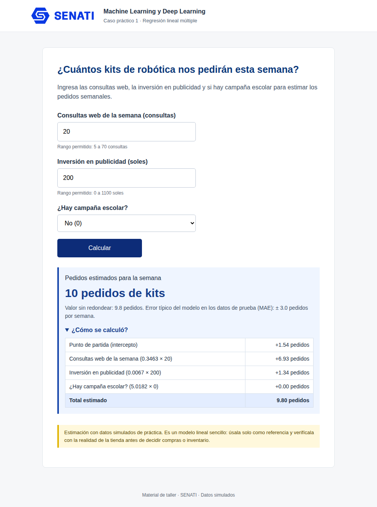
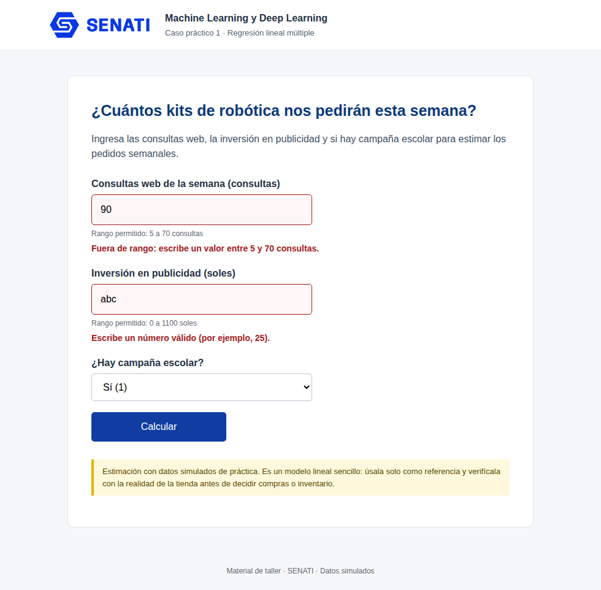

# Caso 01 — Sistema de estimación de pedidos de kits de robótica

Taller de Machine Learning y Deep Learning · SENATI · Regresión lineal múltiple con scikit-learn y Flask.
Los datos son **simulados**; el resultado es una estimación educativa, no una cifra comercial.

## Resumen

| Elemento | Detalle |
|---|---|
| Variables X | `consultas_web`, `inversion_publicidad_soles`, `campana_escolar` |
| Variable y | `pedidos_kits` |
| Filas | 110 (88 entrenamiento / 22 prueba), separación 80/20, `random_state=42` |
| Modelo | `LinearRegression` — intercepto 1.54 · consultas +0.346 · publicidad +0.0067 por S/ · campaña +5.02 |
| **MAE (prueba)** | **2.95 pedidos** |
| **R² (prueba)** | **0.791** |
| Prueba 1 | 20 consultas, S/ 200, sin campaña → **9.80 ≈ 10 pedidos** |
| Prueba 2 | 55 consultas, S/ 800, con campaña → **30.96 ≈ 31 pedidos** |
| Rangos validados | consultas 5–70 · publicidad S/ 0–1100 · campaña 0/1 |

## Estructura

```
├── datos/datos.csv                    # datos simulados
├── notebooks/01_Caso_para_desarrollar.ipynb   # cuaderno ejecutado (pasos 1 a 4)
├── entrenar.py                        # script de entrenamiento -> genera modelo.json
├── modelo.json                        # intercepto, coeficientes, rangos y métricas
├── app.py                             # aplicación Flask (sin JavaScript)
├── templates/index.html               # formulario y resultado
├── static/estilos.css, logo_senati.png
├── pruebas/pruebas_app.py             # pruebas automáticas (unittest)
├── capturas/                          # capturas de las pruebas en la web
├── docs/EXPLICACION_Y_CONCLUSIONES.md # explicación de 10 líneas, respuestas y límites
├── docs/resultados_pruebas.txt        # salida de las pruebas
├── docs/ENUNCIADO_ENTREGA.md          # enunciado y rúbrica originales
└── requirements.txt
```

## Cómo ejecutarlo

Desde esta carpeta (Python 3.10 o superior):

```bash
python -m venv .venv
# Windows: .venv\Scripts\activate      Linux/macOS: source .venv/bin/activate
pip install -r requirements.txt

python entrenar.py                 # (opcional) reentrena y regenera modelo.json
python app.py                      # web en http://127.0.0.1:5000
python pruebas/pruebas_app.py      # pruebas automáticas
```

`modelo.json` ya está incluido: para usar la web solo se necesita Flask. El cuaderno se abre con
JupyterLab o VS Code (kernel con las bibliotecas de `requirements.txt`).

## Capturas de las pruebas





## Documentación

- Explicación de 10 líneas, respuestas del enunciado y límites del modelo: [`docs/EXPLICACION_Y_CONCLUSIONES.md`](docs/EXPLICACION_Y_CONCLUSIONES.md)
- Enunciado y rúbrica: [`docs/ENUNCIADO_ENTREGA.md`](docs/ENUNCIADO_ENTREGA.md)
